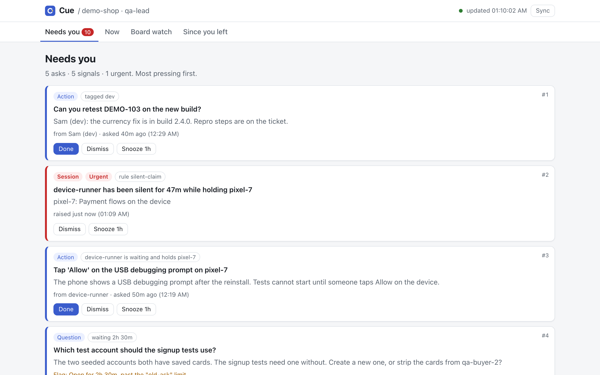
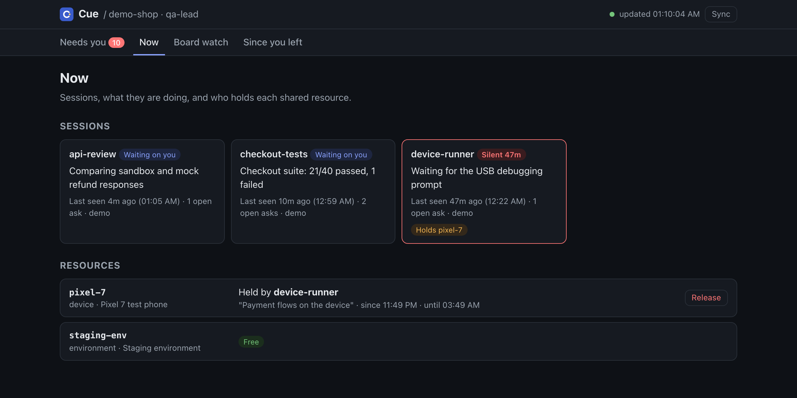
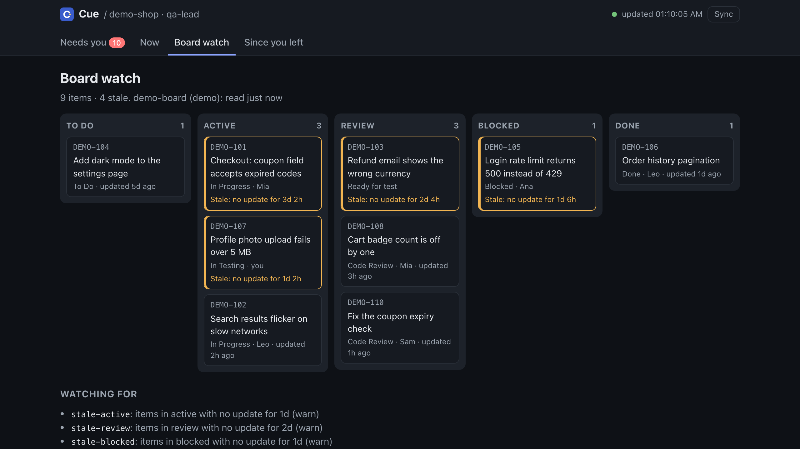
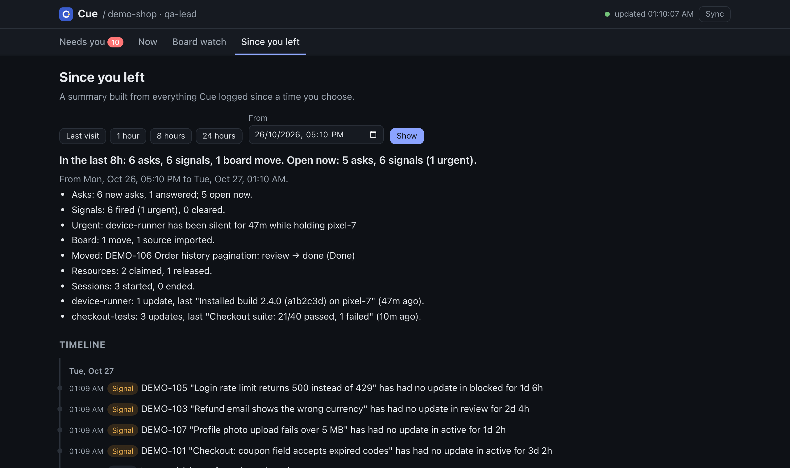
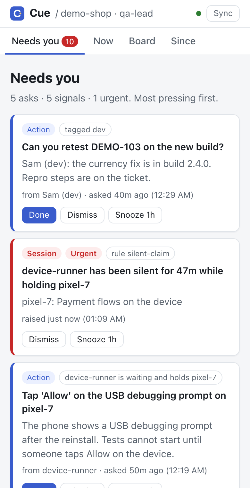

# Cue

[](https://github.com/feben9/cuedesk/actions/workflows/ci.yml)

A local-first chief of staff for one person who runs many AI agent sessions and a ticket board.

Cue keeps one queue of what needs you, watches your board for work that has gone quiet, and stops two sessions from using the same device or environment at once. It runs on your machine, listens on `127.0.0.1` only, and stores everything in one SQLite file.

Package and repo name: `cuedesk`. Status: v0.1, early but working.

## The problem

When you run five agent sessions at once, plus a board, plus people asking you things, four things go wrong:

1. **Asks get lost.** A session stops to wait for an answer or a tap, and its question scrolls away in one of five terminals.
2. **Work goes quiet.** A ticket sits in "In progress" for days. A session holds a test device for an hour and has stopped talking.
3. **Resources collide.** Two sessions drive the same test phone, or change the same config, at the same time.
4. **The same questions every day.** What needs me? What happened while I was away? What do I do first?

## Where it fits

- **Coding-agent managers** (Conductor, Vibe Kanban, Claude Squad) run agents in separate worktrees and help you review their diffs. Cue does not run agents; it coordinates the ones you already run.
- **Approval gates** stop a single risky action until someone says yes. Cue keeps every pending question, approval and chore from every session in one ranked list, and adds board watching and resource claims around it.

## Screenshots

From `cuedesk --demo`: a made-up shop, three agent sessions, one test phone and a small board.

<picture>
  <source media="(prefers-color-scheme: dark)" srcset="docs/screenshots/needs-you.png">
  
</picture>

| Now | Board watch |
|---|---|
|  |  |

| Since you left | Phone width |
|---|---|
|  |  |

## Quick start

You need Node.js 22.6 or newer (22.13+ recommended).

Try the demo, no accounts or config needed:

```sh
npx --yes https://github.com/feben9/cuedesk/releases/download/v0.1.0/cuedesk-0.1.0.tgz --demo
```

Or install it:

```sh
npm install -g https://github.com/feben9/cuedesk/releases/download/v0.1.0/cuedesk-0.1.0.tgz
cuedesk --demo
```

Then open http://127.0.0.1:4520. The demo is a made-up web shop with three agent sessions sending asks and heartbeats, a board with tickets going stale, and two shared resources, one of them held by a session that has gone silent. Data stays in memory and is gone when you stop Cue.

From a clone:

```sh
npm install
npm run demo            # same as: node --experimental-strip-types src/cli.ts --demo
```

## Using it for real

Copy [`cue.config.example.yaml`](cue.config.example.yaml) to `cue.config.yaml`, trim it, and run `cuedesk` in that folder (or `cuedesk --config path/to/cue.config.yaml`).

```yaml
project: my-app
preset: qa-lead            # qa-lead | eng-manager | solo-dev; rules below override it

sources:
  - type: github           # open issues and PRs of a repo
    repo: owner/name
    tokenEnv: GITHUB_TOKEN # optional; the NAME of an env var, never the token
  - type: mcp              # any MCP server you already run
    name: jira
    command: ["npx", "-y", "some-jira-mcp"]
    env: [JIRA_API_TOKEN]
    query: { tool: search_issues, args: { jql: "project = APP AND status != Done" } }
    map: { id: key, title: fields.summary, status: fields.status.name, updated: fields.updated }
    stages:
      active: ["In Progress", "In Testing"]
      review: ["Code Review", "Ready for test"]
      done: ["Done", "Tested"]

resources:
  - { id: tablet-1, kind: device }
  - { id: staging-config, kind: config }

rules:
  - { id: stale-active, when: { stage: active, idleHours: 24 }, severity: warn }
  - { id: silent-claim, when: { session: holdsClaim, silentMinutes: 30 }, severity: urgent }
  - { id: old-ask, when: { ask: open, ageHours: 2 }, severity: warn }
```

Cue checks the whole file at start and lists every problem at once, with the path to it (`sources[1].map.status: required`), a suggestion for typos, and a warning if a secret was pasted where an env var name belongs.

**Presets.** `qa-lead` watches active, review and blocked columns, flags a silent session holding a claim as urgent, and puts asks tagged `dev` first. `eng-manager` cares most about reviews and blockers. `solo-dev` keeps asks from going cold. Rules in your config replace preset rules with the same id; `disabled: true` turns one off.

**Sources.** The GitHub source reads open issues and PRs (draft PRs count as active, open PRs as in review, labels can map to any stage). The MCP source connects to any MCP server as a client, calls the tool you name, and maps fields by dotted path, so Jira, Linear or an in-house tracker work through the MCP servers you already use. Cue only reads in v0.1.

## Hooking up Claude Code

**Hooks** tell Cue when a session starts, stops, ends, or waits for you.

```sh
cuedesk hooks install                    # prints the settings snippet; changes nothing
cuedesk hooks install --write ~/.claude/settings.json   # merges it in, keeps a .cuedesk-backup copy
```

Paste the printed `hooks` block into your Claude Code settings (`~/.claude/settings.json` for all projects, or `.claude/settings.json` in one repo), or use `--write` with the file you choose. Each hook pipes its JSON to `POST /api/hooks/claude` with `curl`, gives up after 3 seconds and never fails, so a stopped Cue never blocks Claude Code.

Checked with a real Claude Code session (v2.1): starting a session, a permission prompt (it shows up in Needs you as an approval within a second), finishing a turn, and ending the session all reach Cue. Declining the prompt in the terminal closes the card on its own.

| Hook | What Cue does |
|---|---|
| `SessionStart` | records the session (labelled by folder and short id) |
| `Notification` | opens an ask: permission prompts become approvals, idle prompts become questions |
| `Stop` | marks the session idle and closes the asks it raised (you handled them in the terminal) |
| `SessionEnd` | ends the session and releases any resources it still holds |

**MCP tools** let a session ask you things, claim resources and report progress:

```sh
claude mcp add --transport http cue http://127.0.0.1:4520/mcp
```

| Tool | What it does |
|---|---|
| `ask_human(summary, details?, kind?, dueMinutes?, tags?, waitSeconds?)` | puts a question (`answer`), yes/no (`approve`) or chore (`action`) in your queue; returns an `askId`, or waits for the answer |
| `get_answer(askId, waitSeconds?)` | the answer, once you give it in the UI |
| `report_progress(summary, item?)` | logs progress; counts as a heartbeat |
| `claim_resource(resourceId, reason, minutes)` | takes a device, environment or account; refused while another session holds it, and the refusal names the holder |
| `release_resource(resourceId)` | gives it back (holder only) |
| `whats_next()` | the ranked Needs-you list and current priorities |
| `list_sessions()`, `list_signals()` | sessions with what they hold; signals from the rules |
| `since(timestamp)` | a summary of what happened since a time (ISO date, epoch ms, or `8h`) |

Every tool takes an optional `session` (an id or a short label such as `checkout-tests`). Without it, each MCP connection counts as its own session.

**HTTP API.** Scripts get the same operations as JSON: `POST /api/<tool>` for any tool, `GET /api/<tool>` for the read-only ones (`/api/whats_next`, `/api/sessions`, `/api/since?ts=8h`), plus `/api/state` and the ask, signal and resource actions the UI uses. Name the session with a `session` field or an `X-Cue-Session` header.

## The UI

- **Needs you:** asks and signals in one ranked list. Urgent signals and overdue asks come first, then asks from a session that holds a claim (a device sits idle until you answer), then the rest, oldest first. Presets reorder these tiers. Each card has its actions: Answer, Approve or Reject, Done, Dismiss, Snooze.
- **Now:** sessions, what each is doing and when it was last seen, plus resources and who holds each. You can release a claim by hand.
- **Board watch:** items by stage, with stale ones highlighted, and the rules being watched.
- **Since you left:** a plain summary built from the event log since a time you choose (last visit, 1 h, 8 h, 24 h or a date).

It refreshes every 5 seconds, follows your system's light or dark setting, and works at phone width. No external scripts, fonts or CDNs.

## Security model

- Cue binds to `127.0.0.1` only. It is a single-user, local tool; there are no accounts.
- Every request must carry a `Host` of `127.0.0.1`, `localhost` or `[::1]` on Cue's port. This blocks DNS-rebinding pages.
- A request with an `Origin` header must come from Cue's own page. Other sites, including other apps on other localhost ports, get `403`. Cue never sends CORS headers, and POST bodies must be `application/json`, which forces a browser preflight that Cue refuses.
- The page is served with a strict Content-Security-Policy (`default-src 'none'`, own scripts and styles only) and `frame-ancestors 'none'`.
- Secrets stay in environment variables. Config holds only their names; MCP source servers get only the env vars you list.
- `hooks install` writes nothing unless you pass `--write <path>`, and then backs up the old file first.
- Cue reads from your trackers and never writes to them in v0.1.

## How it is built

Node.js and TypeScript, with very few dependencies: the official MCP SDK and `yaml`. `node:http` serves the UI, the API and the MCP endpoint (Streamable HTTP). `node:sqlite` stores sessions, asks, items, resources, claims, signals and events in one file (default `~/.cuedesk/<project>.sqlite`). The UI is static HTML, CSS and plain JavaScript. Tests use `node:test`.

```
src/store      SQLite schema and data access
src/config     load, validate and merge presets
src/sources    GitHub (REST) and generic MCP sources
src/rules      watch rules → de-duplicated, self-resolving signals
src/ranking    whats_next ordering
src/ingest     Claude Code hooks, and the hooks installer
src/mcp        MCP server and the shared tool definitions
src/server     HTTP server, Host/Origin checks, JSON API
ui/            the web UI
```

Development:

```sh
npm install
npm test             # node:test, run on the TypeScript source via type stripping
npm run typecheck
npm run build        # compiles to dist/ for the package
```

## Roadmap

- **v0.1 (this release):** core model and SQLite store; Claude Code hooks; MCP server; GitHub and generic MCP sources; rules engine; web UI with four views; demo mode; presets.
- **v0.2:** Slack DM brief and urgent push, full quiet hours, approved tracker writes through the same MCP connectors, a promise tracker ("X said they'd do Y by Z").
- **v0.3:** a build desk (resumable, verified artifact downloads), a capacity forecast, and a decision log ("did I already decide this?").

## About me

I'm Feben Tibebe, a QA lead building AI-assisted QA workflows. I run several Claude Code sessions against shared test devices and a ticket board every day, and Cue is the tool I wanted for that. Nothing in it is QA-specific, though.

LinkedIn: https://www.linkedin.com/in/febentibebe/

## License

MIT. See [LICENSE](LICENSE).
